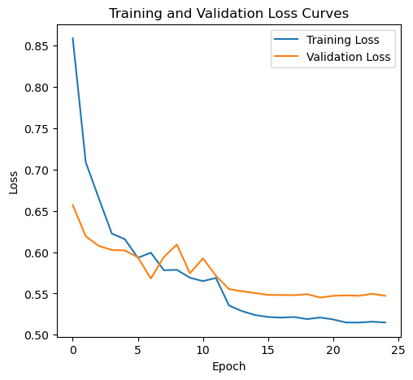
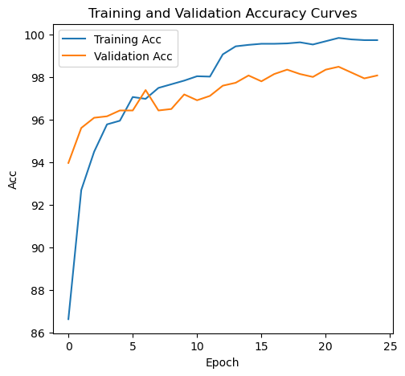

# HW1 手寫數字分類

[課程首頁](../../README.md) · [程式索引](FILES.md) · [結果圖](RESULTS.md)

## 問題與目的

以 16 × 16 灰階手寫數字預測 0 至 9 類別，建立完整的監督式學習流程。雖然這份資料不是醫學影像，但它是後續作業的基礎：資料讀取、Dataset／DataLoader、訓練與驗證分割、損失函數、checkpoint 選擇及預測檔輸出。

用途是理解影像分類與實驗管理，不是把手寫數字結果當成醫學診斷能力證明。

## 程式與資料

主要程式：[digits.ipynb](notebooks/digits.ipynb)。原資料為兩個 CSV：訓練包含影像識別欄、label 與 256 個像素；測試沒有 label。歷史紀錄有 7,291 筆訓練資料與 2,007 筆測試資料。

`HandwrittenDigits` 把一張影像攤平成 256 維 float32 向量。訓練模式回傳 ID、label、image；測試模式只回傳 ID、image。資料本身不在公開 repository，需自行準備有權使用的檔案並設定 `config.root`。

## 模型設計

```text
256 → 1024 → 512 → 512 → 512 → 256 → 10 logits
```

五個隱藏層使用 Linear、BatchNorm1d、ReLU；中間三處加入 Dropout(0.1)。輸出層不先套 Softmax，交給 CrossEntropyLoss 處理 logits，避免重複轉機率。

完整可訓練參數為 1,452,810；可由 Linear 的 `(input+1)*output` 加上 BatchNorm 的 scale／bias 計算。這個數量比影像的 256 維輸入大很多，正則化與驗證的重要性也因此提高。

| 設定 | 提交版本 |
| --- | --- |
| train／validation | 80／20 隨機分割，seed=7 |
| batch size | 16 |
| epochs | 25 |
| optimizer | AdamW，lr=0.001、weight_decay=0.01 |
| scheduler | StepLR，每 12 epochs × 0.1 |
| loss | CrossEntropyLoss，label_smoothing=0.1 |
| 選模型 | 以最低 validation loss 儲存 checkpoint |

Seed 有助於重現同環境操作，但不是所有 GPU／套件版本均得到完全一致結果的保證。

## 執行流程

1. 讀 CSV，統計各類別樣本數並檢查輸入維度。
2. 將訓練資料切為 train／validation；原碼兩者均使用 Dataset 的 train 分支取值。
3. 每 epoch 執行前向傳播、反向傳播、optimizer update，之後更新 scheduler。
4. 切換 eval 與 no_grad 計算 accuracy、macro-F1、misclassification rate。
5. 保存最低 validation loss 的權重與 optimizer／scheduler 狀態。
6. 將測試資料以固定順序讀取，載入 checkpoint，輸出預測類別 CSV。

若只輸出 argmax class，不代表另外已匯出每類機率；目前最終 CSV 是 ID／Class 兩欄。

## 歷史結果與分析

第 25 epoch：train accuracy 99.74%、validation accuracy 98.08%、validation macro-F1 97.87%、misclassification 1.92%。第 22 epoch 曾記錄 validation accuracy 98.49%，但最佳 checkpoint 由 loss 而非最高 accuracy 選擇，兩者不可混用。





訓練 loss 持續下降，驗證 loss 約在後半段趨於平緩，顯示繼續增加訓練不一定等比例改善泛化。Dropout、weight decay、label smoothing 是程式實際採用的方法，但沒有保留完整消融實驗，因此不能量化單一方法貢獻多少。

## 執行與輸出

依 [環境說明](../../docs/ENVIRONMENT.md) 安裝適用套件，在 Notebook 中設定包含 `zip.train.csv`、`zip.test.csv` 的 `config.root`。先確認資料結構，再依順序執行；輸出包含 `checkpoint.pth`、loss／accuracy／F1 曲線及 `test.digit.csv`。這些資料與產物不公開上傳。

## 已知問題與可改善方向

- Dataset 的 `mode="valid"` 分支有錯誤的陣列 unpacking；目前主流程繞用 train 分支。不能把主流程曾有輸出當作所有介面均正確。
- 驗證分割未使用 stratify；目前只有一次固定 split，沒有多 seed 或 confidence interval。
- 類別比例不均，總 accuracy 應搭配 macro-F1 與每類 recall，不宜單看總分。
- 原碼會保存含 config 物件的 checkpoint，重載與套件版本／pickle 安全性有關，只應讀取可信權重。

這份實驗可用來觀察 validation loss 選模、正則化的取捨，以及「末輪 accuracy」與「最佳 checkpoint 測試成績」的差異。本次未重訓；公開曲線都是既有歷史紀錄。
