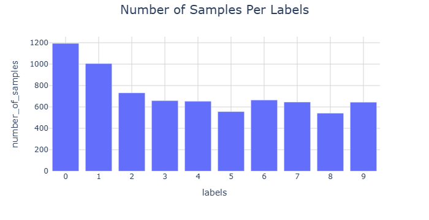
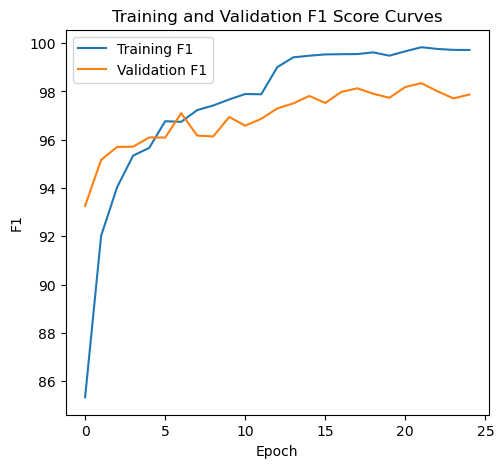
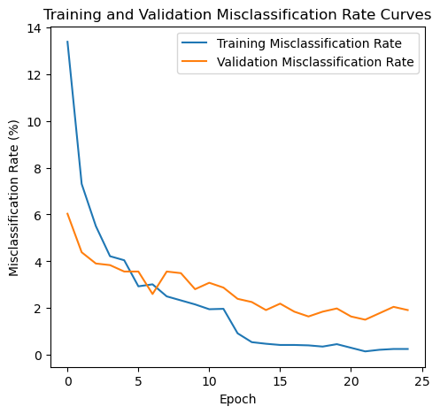

# 公開結果證據

[作業說明](README.md) · [程式索引](FILES.md)

共 5 張經審查的歷史圖表／截圖。全部來自原 Notebook 或本人 Word 報告，不是本次重訓產生；不包含病患影像、遮罩或個案表。結果意義與限制請配合作業 README。

## 01 原報告的十類訓練樣本數統計

## 02 手寫數字歷史 loss 曲線

## 03 手寫數字歷史 accuracy 曲線

## 04 手寫數字歷史 macro-F1 曲線

## 05 手寫數字歷史 misclassification 曲線

