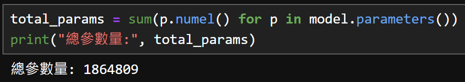

# HW2 SPECT 三類疾病分期分類

[課程首頁](../../README.md) · [程式索引](FILES.md) · [結果證據](RESULTS.md)

## 問題與目的

利用 SPECT 多幀影像，以及年齡、性別欄位，預測課程定義的三類分期。練習醫學影像 Dataset、切片選取、ImageNet 遷移學習與影像／表格特徵融合。

這是課程分類任務，沒有驗證臨床效益；不把模型分期輸出當作實際診斷或醫療建議。

## 程式與資料需求

主程式：[spect_classification.ipynb](notebooks/spect_classification.ipynb)，同一 Notebook 含 VGG、ResNet 與 ViT 實驗區段。歷史資料說明有 161 筆訓練、41 筆測試，欄位包含 ID、Age、Gender、FilePath、index、Stage；公開版只描述 schema，不提供任何個案列。

輸入的 index 是 0-based。`ParkinsonsDataset` 讀取 DICOM 的 `pixel_array`，取 `image[index-1:index+2]` 三張相鄰切片作為三個 channel，並不是三種影像模態。需確認 index 不在邊界，否則取到的切片數可能不是 3。

## 前處理與模型

- VGG／ResNet 使用 50 × 50 center crop，ViT 使用 56 × 56。
- 訓練資料另有水平翻轉與 ±15° 旋轉，驗證不加隨機增強。
- 每筆影像以 min-max 正規化；常數影像的分母為 0，原碼沒有完整防護。
- 影像 backbone 輸出與 age、gender 串接後進入分類頭，輸出三個 logits。

| 模型 | 實際設計 | 需注意的地方 |
| --- | --- | --- |
| VGGplus | VGG16 ImageNet 特徵，去除最後 pooling／classifier 的部分設定，AdaptiveAvgPool2d(1)，512+2 → 3 | 可選擇凍結／微調 features |
| ResNetplus | **ResNet18**，fc 改 Identity，512+2 → 3 | 部分原註解寫 ResNet50，但實際呼叫 resnet18 |
| VisionTransformerCustom | img_size=56、patch_size=16、embed_dim=96、depth=16，96+2 → 3 | 不是已證明使用預訓練 ViT；56 與 16 不整除，需核對 timm 版本與 patch 行為 |

使用 pretrained CNN 不表示 ViT 也有 pretrained weights。未做 metadata 消融比較，因此只能說模型「納入」年齡與性別，不能宣稱已證明它們提高準確率。

## 訓練與預測

設定 seed=42、train／validation=80／20、batch size=64、config epochs=80。Stage 1..3 在 loss 前轉為 0..2，輸出時再對回課程類別。

VGG、ResNet、ViT 各區段重新定義 `main`、`testing` 等函式，optimizer／scheduler 也不同。VGG 片段使用 OneCycleLR，ResNet 使用 StepLR，ViT 使用 CosineAnnealingLR；不能只看最上方 config 就假設全部實驗完全一致。

Notebook cell 的執行順序是實驗的一部分。不要抽取最後一個 `main` 再假設它代表前面所有模型；舊 checkpoint 也不能跨架構直接使用。

## 保存的結果與界線

原提交 Notebook 保留一段到 `Epoch[30/80]` 的歷史日誌，該行 validation accuracy 為 69.70%、macro-F1 59.29%。因輸出只保存部分區段且可能與後來修改的程式設定不完全同步，**不將這筆數字當作 ViT 最終測試成績，也不建立三模型排行榜**。

原報告的 ViT 參數截圖記錄 1,864,809：

這是原報告紀錄，未在本次重新初始化 PyTorch／timm 模型確認。其他輸出還有不同模型的總參數；應區分完整 backbone、task model 與 requires_grad 的計算範圍。

報告描述準確率停在約 70% 與資料不足等問題，可作為當時的觀察。沒有控制實驗足以斷言「Transformer 不適合醫學影像」或指定因素是唯一原因。

## 如何操作與應用

準備有權使用的 `hwk02_data`、資料表及 DICOM，依各區段設定 `config.root`；原碼以字串相加組成部分影像路徑，須檢查 FilePath 是否自帶分隔符。依序執行前處理、指定模型訓練、載入對應 checkpoint 與 CSV 匯出。環境與下載依賴見 [ENVIRONMENT](../../docs/ENVIRONMENT.md)。

此實作結合資料模態轉換、凍結／微調策略與特徵融合。部署前仍需整理成獨立訓練入口、統一標準化與版本、檢查 split／label mapping，並做外部評估。

## 已知限制

- age／gender 直接串接，未證明其尺度與群組偏差已妥善控制。
- OneCycleLR 區段設定 steps_per_epoch，但共用 train 函式在 epoch 結束才 step，需核對其排程用法，不能當成已正確完成完整 cycle。
- 重建 ResNet conv1 後是否保持原預訓練初始化，應與直接沿用 conv1 的版本比較。
- 沒有完整保留三模型的相同資料分割／重複量測／外部測試結果。
- 醫學影像未公開，Notebook 格式／語法通過不代表訓練與推論已在本次重現。
