# 公開結果證據

[作業說明](README.md) · [程式索引](FILES.md)

共 23 張經審查的歷史圖表／截圖。全部來自原 Notebook 或本人 Word 報告，不是本次重訓產生；不包含病患影像、遮罩或個案表。結果意義與限制請配合作業 README。

## 01 完整訓練資料的六類分布

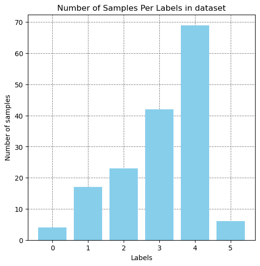

## 02 分割後訓練部分的六類分布

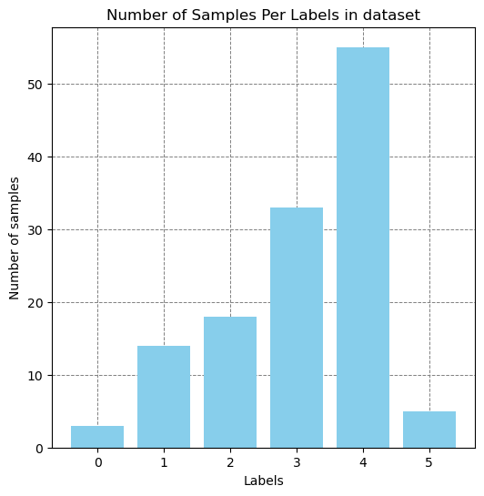

## 03 Random Oversampling 實驗的歷史 loss 曲線

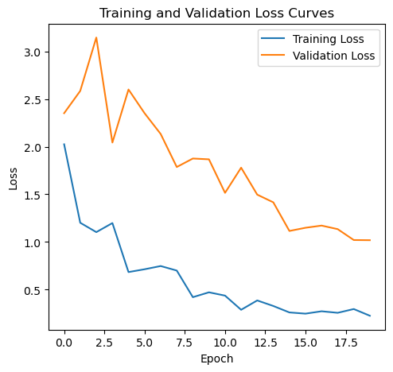

## 04 Random Oversampling 實驗的歷史 accuracy 曲線

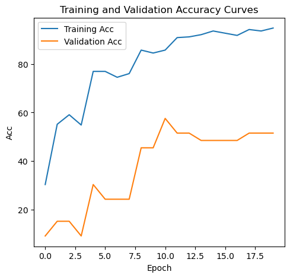

## 05 Random Oversampling 實驗的歷史 macro-F1 曲線

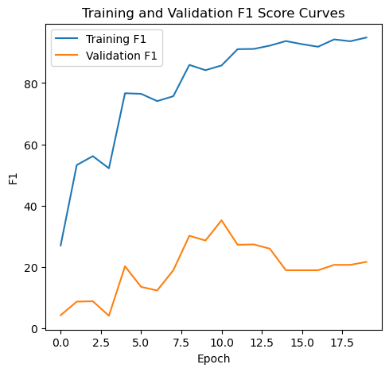

## 06 Random Oversampling 實驗的歷史 misclassification 曲線

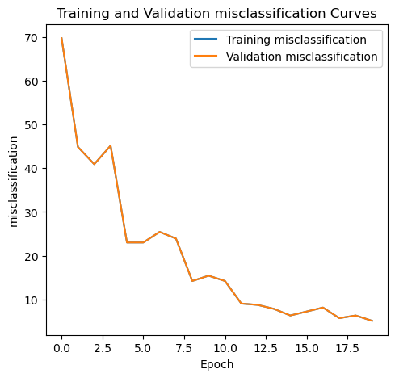

## 07 標名 weighted-loss 的實驗（原碼未將 weight 傳入 loss）的歷史 loss 曲線

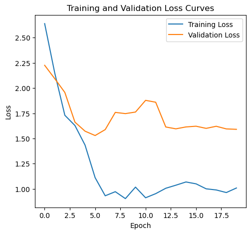

## 08 標名 weighted-loss 的實驗（原碼未將 weight 傳入 loss）的歷史 accuracy 曲線

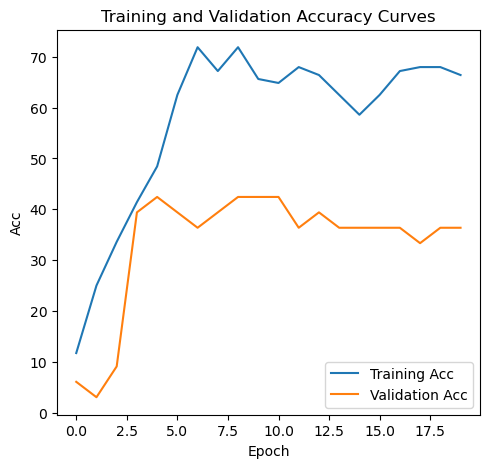

## 09 標名 weighted-loss 的實驗（原碼未將 weight 傳入 loss）的歷史 macro-F1 曲線

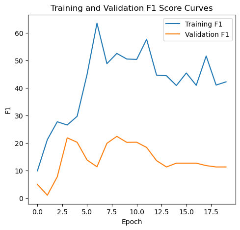

## 10 標名 weighted-loss 的實驗（原碼未將 weight 傳入 loss）的歷史 misclassification 曲線

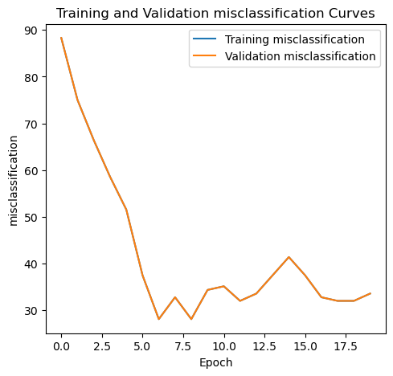

## 11 MRI Late_fusion 歷史 loss 曲線；名稱不保證架構互異

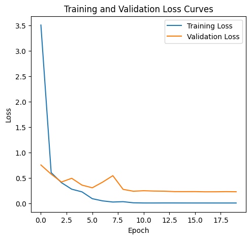

## 12 MRI Late_fusion 歷史 accuracy 曲線；名稱不保證架構互異

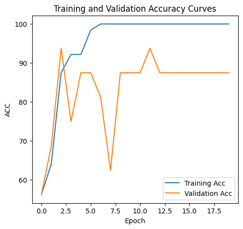

## 13 MRI Late_fusion 歷史 macro-F1 曲線；名稱不保證架構互異

## 14 MRI Single_slice 歷史 loss 曲線；名稱不保證架構互異

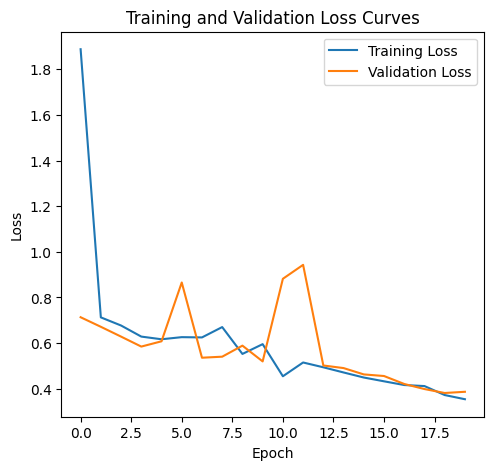

## 15 MRI Single_slice 歷史 accuracy 曲線；名稱不保證架構互異

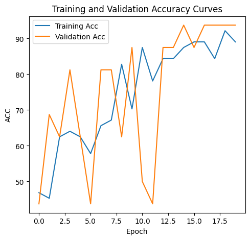

## 16 MRI Single_slice 歷史 macro-F1 曲線；名稱不保證架構互異

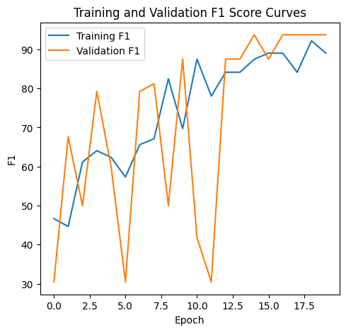

## 17 MRI Early_fusion 歷史 loss 曲線；名稱不保證架構互異

## 18 MRI Early_fusion 歷史 accuracy 曲線；名稱不保證架構互異

## 19 MRI Early_fusion 歷史 macro-F1 曲線；名稱不保證架構互異

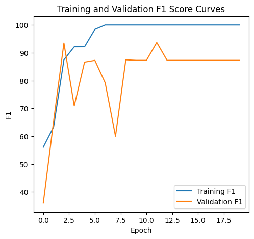

## 20 MRI 3D ResNet 歷史 loss 曲線；名稱不保證架構互異

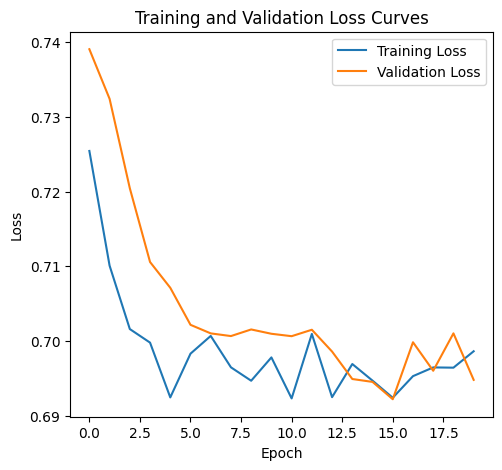

## 21 MRI 3D ResNet 歷史 accuracy 曲線；名稱不保證架構互異

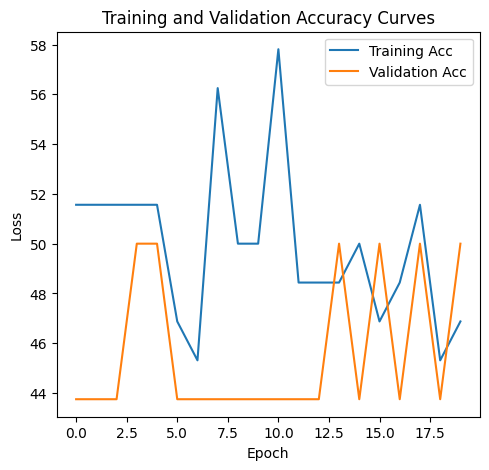

## 22 MRI 3D ResNet 歷史 macro-F1 曲線；名稱不保證架構互異

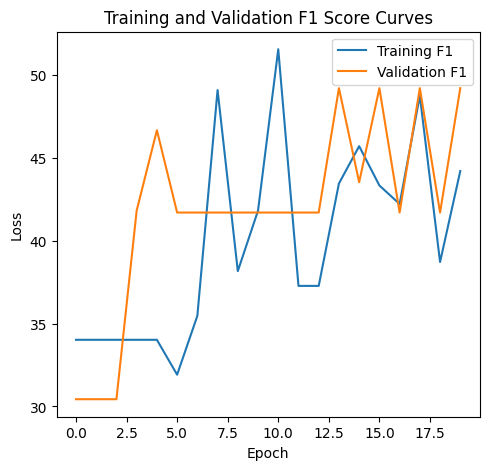

## 23 22,530 是凍結 backbone 時的可訓練分類頭數量，不是完整模型總量

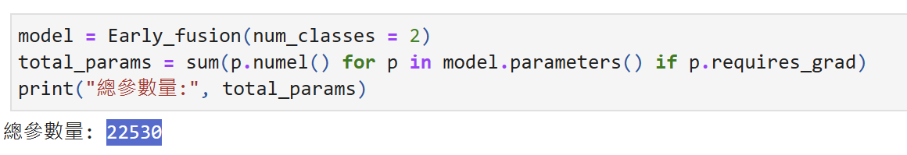
