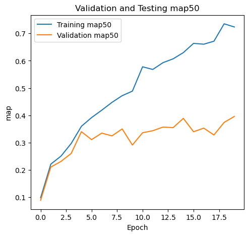
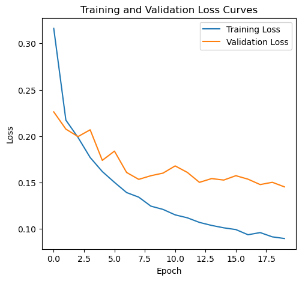

# HW5 胸腔 X 光異常區域偵測

[課程首頁](../../README.md) · [程式索引](FILES.md) · [公開結果圖](RESULTS.md)

## 問題與目的

在胸腔 X 光影像中偵測異常區域，輸出 bounding box、類別與 confidence score。與整張圖分類不同，一張影像可能有多種異常、各自位於不同區域，因此需要同時處理分類與定位。

課程定義七種異常類別，另有 normal：主動脈硬鈣化、主動脈彎曲、肺野浸潤增加、胸椎退化性關節病變、脊椎側彎、肺尖肋膜增厚、心臟肥大。這是既有課程標籤，不是本專案提出或驗證的醫療診斷標準。

## 三階段程式

| 階段 | Notebook | 功能 |
| --- | --- | --- |
| 1 | [preprocessing.ipynb](notebooks/preprocessing.ipynb) | DICOM 正規化、標註轉 box、依 subject 分割、COCO JSON／JPG |
| 2 | [explainability.ipynb](notebooks/explainability.ipynb) | 載入偵測模型，使用 EigenCAM／AblationCAM 疊圖 |
| 3 | [detection_training.ipynb](notebooks/detection_training.ipynb) | Dataset、Faster R-CNN 訓練、COCO 評估、checkpoint 與 CSV 推論 |

[前處理子題](preprocessing/README.md) · [訓練子題](training/README.md) · [可解釋性子題](explainability/README.md)

公開版不包含實際影像、標註、JSON 個案資料、CAM 圖、預測表或 .pth。偵測 helpers 來自課程沿用的 Torchvision references，來源與授權在 [THIRD_PARTY](notebooks/THIRD_PARTY.md)，不宣稱整個偵測框架由本人從零寫成。

## 資料表示與前處理

原資料表有 451 筆訓練影像／類別紀錄，**不等於 451 位不同病患**；同一 ID 可能出現多種異常。程式先把相同 ID 的類別集合做 MultiLabelBinarizer，再以 iterative train-test split 切 unique ID，讓同一人的多筆標註留在同一集合。

這是比直接逐列 split 更合理的資料單位，但分割比例與重採樣仍需以實際資料檢查；本次只審閱流程，沒有重新載入個案資料驗證 split。

前處理順序：

1. 讀 DICOM 像素與 Window Center／Width、BitsStored。
2. Clip 至 window 範圍，計算 `-log((1+x)/2^BitsStored)`。
3. 以 log 後值的第 5／95 百分位伸縮到 0..1，再 clip。
4. 從標註圖非零 connected components 建立 box。
5. 依受試者分 train／validation，建立 COCO images／annotations／categories。
6. 將授權本機影像轉 JPG，供後續 Dataset 讀取。

原 normalization 函式的 vmin／vmax 參數未被實際用於伸縮，程式改用 percentiles；不能把題目指定的固定 0／2.5 當成已完全照做。

標註轉 box 只保留面積至少 3000 的**第一個**區域；多個病灶／小區域可能丟失，沒有區域時可能索引錯誤。這是需要改善的前處理限制。

## 模型與訓練

使用 `fasterrcnn_resnet50_fpn(weights='COCO_V1')`，將原 head 換成 `FastRCNNPredictor`。模型 8 個輸出索引是 **background + 7 異常類別**，不是 8 種疾病；normal 樣本以空 boxes 代表，並非正常胸腔的特定 box。

資料先 resize 到 512 × 512，再透過 torchvision v2／BoundingBoxes 同步更新影像與 box。COCO 的 box 格式是 XYWH，送入偵測 target 前轉成 XYXY；格式與 canvas 尺寸都是必要契約。

| 設定 | 提交版本 |
| --- | --- |
| seed／epochs／batch | 42／20／8 |
| optimizer | SGD，lr=0.001、momentum=0.8、Nesterov=True |
| weight decay | 0.005 |
| 訓練損失 | ROI classifier、box regression、RPN box regression、objectness 四項相加 |
| 選 checkpoint | 以 validation AP50 改善時保存最佳模型 |
| 最終輸出門檻 | score > 0.5，略過 background |

報告提到翻轉／旋轉等增強，但訓練 Notebook 的相關幾何增強行目前是註解，不列為已啟用。validation loss 使用 train mode 取得 loss dict，並凍結部分 normalization 行為；真正 AP 評估則經 eval 的偵測輸出計算，兩種模式用途不同。

## 歷史結果

第 20 輪的 COCO 評估與原報告一致，以下為保存紀錄，不是本次重訓：

| 指標 | Train | Validation |
| --- | --- | --- |
| AP@[IoU .50:.95] | 0.479 | 0.222 |
| AP50 | 0.724 | 0.396 |
| AP75 | 0.570 | 0.249 |

原圖標題的 `Testing` 實際對應 validation，不是未知標籤的獨立 test。AP50 是在 IoU 門檻 0.5 的偵測 precision-recall 評估，不是 39.6% 的病患診斷 accuracy。

Train／validation 差距顯示泛化不足的風險；objectness loss 的 validation 曲線未跟隨 train 持續降低，也不支持「loss 下降已證明臨床可用」。應檢查每類 AP、陰性樣本誤報、多框標註完整性與獨立 subject 的結果。

## CAM 的目的與界線

第二份 Notebook 使用外部 [pytorch-grad-cam](https://github.com/jacobgil/pytorch-grad-cam) 的 EigenCAM 與 AblationCAM，觀察偵測特徵關注區域。這有助於除錯與展示，但熱力圖本身不是 ground truth，也不能證明模型關注的是病理原因或與醫師一致。

含原 X 光的 CAM 圖未公開；面試可閱讀流程與程式，但不提供未確認再散布權的病患畫面。可解釋性分析與訓練指標分開，不將視覺效果當成增加 AP 的實驗證據。

## 推論輸出與已知問題

預期 CSV schema 是 `ID,category,score,xmin,xmax,ymin,ymax`，座標應以**同一座標系**的影像寬高正規化。程式能產生 CSV，不代表座標已完全正確。

目前推論先將影像 resize 到 512 × 512，取得該 canvas 的預測框，卻除以原 JPG 的 W／H。若原圖不是 512 × 512，比例將不一致；應改為除以 512，或先把框反算回原尺寸再除原 W／H。此整理保留原碼並註明缺陷，沒有把歷史 CSV 當成重新驗算過的正確輸出。

其他需要核對的事項：類別 ID 與 category 列表的一致性、empty target、normal 定義、多病灶框、bbox 邊界及模型內部 resize。訓練與推論 Notebook 重新定義 config，不能假設所有參數自動延續。

## 執行方式與用途

準備授權課程資料，依序執行 preprocessing、training，再以同一 checkpoint 執行 explainability／推論；詳細資料契約與套件見 [ENVIRONMENT](../../docs/ENVIRONMENT.md)。偵測 helpers 放在 Notebook 同目錄；應從該目錄啟動 kernel 或明確設定 import 路徑。

此作業可展示多標籤資料工程、COCO 格式、遷移學習、偵測損失、AP 評估與 XAI 整合。實際應用前仍需先修正座標與標註處理，再做外部受試者、模型校正與臨床安全性評估；本專案沒有完成這些部署條件。
