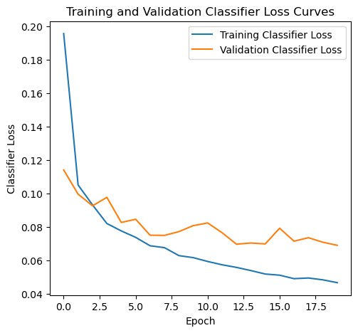
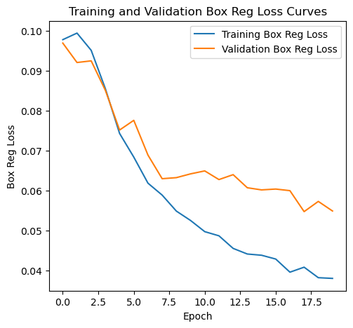
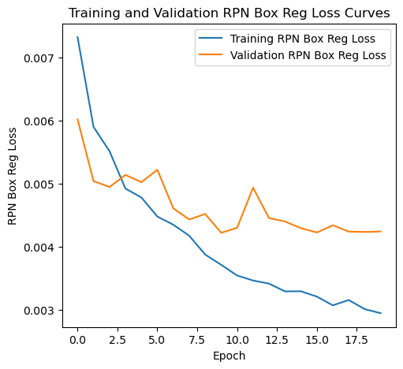
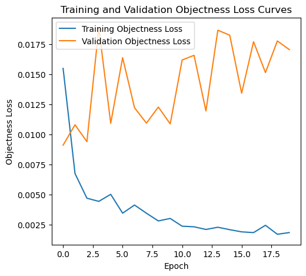

# 公開結果證據

[作業說明](README.md) · [程式索引](FILES.md)

共 6 張經審查的歷史圖表／截圖。全部來自原 Notebook 或本人 Word 報告，不是本次重訓產生；不包含病患影像、遮罩或個案表。結果意義與限制請配合作業 README。

## 01 Faster R-CNN 歷史 AP50 曲線；原圖 Testing 字樣實為驗證集

## 02 Faster R-CNN 歷史 total loss 曲線；原圖 Testing 字樣實為驗證集

## 03 Faster R-CNN 歷史 classifier loss 曲線；原圖 Testing 字樣實為驗證集

## 04 Faster R-CNN 歷史 box regression loss 曲線；原圖 Testing 字樣實為驗證集

## 05 Faster R-CNN 歷史 RPN box loss 曲線；原圖 Testing 字樣實為驗證集

## 06 Faster R-CNN 歷史 objectness loss 曲線；原圖 Testing 字樣實為驗證集

